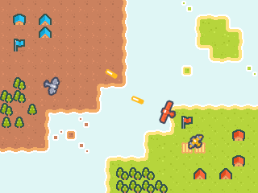

# Godot + C#15 Sample

This is a sample project built for .NET Conf 2026 demonstrating [new C#15 features](https://learn.microsoft.com/dotnet/csharp/whats-new/csharp-15#extension-indexers) and how they can be used with Godot.

The project specifically targets .NET 8 and uses [PolySharp](https://github.com/Sergio0694/PolySharp) to demonstrate the new C#15 features as an example. The project can also just directly target .NET 11.

TODO: Embed YouTube video of talk, once available

## Features Demonstrated

- Unions ([Player.cs](Player.cs))
- Closed Type Hierarchies ([States/EnemyStates.cs](States/EnemyStates.cs))
- Extension Indexers ([helpers/NodeExtensions.cs](helpers/NodeExtensions.cs))
- Labeled Break/Continue ([Main.cs](Main.cs))

## About this Project

A simple demonstration project showing three planes:

1. A red plane controlled by the player.
2. A yellow plane which follows the player.
3. A gray plane which seeks a nearby target.

The player can shoot bullets to defend themselves.

It was built with Rider 2026.3, Godot 4.7, and .NET 11.

## License

Code is licensed under MIT

[Assets are CC0 from Kenney - Pixel Shmup](https://kenney.nl/assets/pixel-shmup) - [See images/license.txt](images/license.txt)
